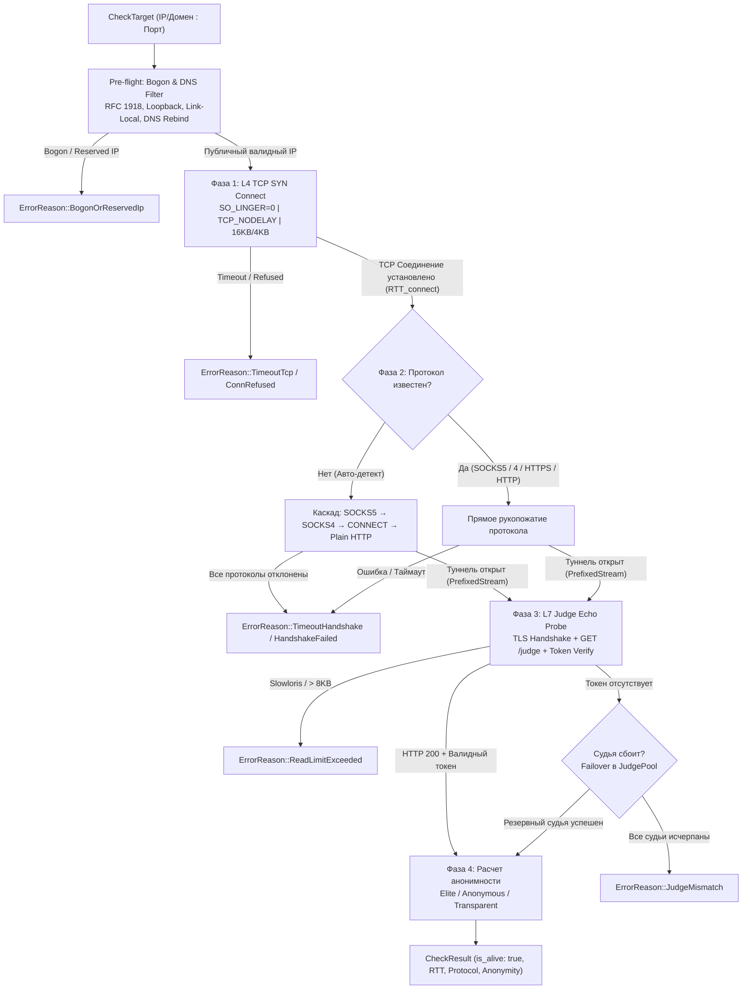
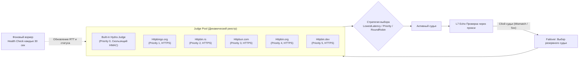

# Hydra Checker — High-Throughput Asynchronous Proxy Verification Core

[-dea584?style=flat-square&logo=rust&logoColor=white)](https://www.rust-lang.org/)
[](../LICENSE)
[](https://tokio.rs/)
[](../BENCHMARK_RESULTS.md)
[](https://github.com/)
[](../BENCHMARK_RESULTS.md)

[Возможности](#возможности) • [Архитектура](#архитектура-конвейера-проверок) • [Системные требования](#системные-требования) • [Быстрый старт](#быстрый-старт) • [Использование как библиотека](#использование-как-библиотека) • [Конфигурация](#конфигурация) • [Производительность](#производительность-и-бенчмарки) • [Диагностика и FAQ](#диагностика-и-faq) • [Связанные компоненты](#связанные-компоненты) • [Участие в разработке](#участие-в-разработке) • [Лицензия](#лицензия)

---

**Hydra Checker** — это автономное высокопроизводительное асинхронное ядро верификации прокси на Rust (Rust 2024), решающее задачу сверхбыстрой параллельной валидации, фильтрации и классификации миллионов прокси-серверов в секунду без утечек файловых дескрипторов, зависания сокетов в `TIME_WAIT` и ложных отсевов из-за сбоев судейских эхо-серверов.

Движок разработан для работы в составе распределенного комплекса [Hydra](../README.md), а также как независимая библиотека (`hydra_checker`), готовая к интеграции в высоконагруженные сетевые сервисы, парсеры и сканеры.

---

## Возможности

Формула каждого технического решения в Hydra Checker: **Техническая особенность → Выгода разработчика**.

- **4-фазный Fail-Fast конвейер проверки** → Отсечение неработающих хостов на самых ранних стадиях без инициализации дорогостоящих TLS-сессий и рукопожатий, экономя до 95% CPU и трафика.
- **Превентивный Bogon & SSRF фильтр** → Мгновенная отбраковка частных (RFC 1918), link-local, loopback, CGNAT адресов и защита от DNS Rebinding атак до открытия L4-сокета.
- **Ядерный твикинг сокетов (`SO_LINGER=0`, `TCP_NODELAY`, малые буферы)** → Принудительный сброс сокета пакетом `RST` гарантирует мгновенное освобождение эфемерных портов и нулевой оверхед по памяти (16 KB RX / 4 KB TX) под нагрузкой 5 000+ одновременных проверок.
- **Каскадный авто-детект протоколов (SOCKS5 → SOCKS4/4a → HTTP CONNECT → Plain HTTP)** → Автоматическое определение реального протокола узла без необходимости предварительного указания типа прокси в исходных списках.
- **Zero-Copy префиксный буфер (`PrefixedStream`)** → Передача байтов из ответа `HTTP/1.1 200 Connection Established` прямо в TLS-рукопожатие без копирования в куче и потери кадров.
- **Отказоустойчивый пул судей (Judge Pool) с мгновенным Failover** → Встроенный локальный судья и 5 преднастроенных внешних HTTPS-судей с фоновым мониторингом здоровья каждые 30 секунд; сбой судьи переключает запрос на резервный узел без браковки валидного прокси.
- **Двухрежимная аутентификация эхо-токенов** → Поддержка статических секретов и динамической посуточной ротации HMAC-SHA256 со скользящим окном 30 минут на границе полуночи UTC исключает подделку прокси-трафика и ложные срабатывания.
- **Строгая типизация ошибок (`ErrorReason`)** → Детерминированная диагностика причин недоступности узлов (таймауты, сбросы, прокси-ловушки, невалидные сертификаты) для точной аналитики и скоринга.

---

## Архитектура конвейера проверок

### 1. 4-фазный многоэтапный конвейер (Fail-Fast Pipeline)

Каждая проверка проходит строгую цепочку валидации. При любом сбое проверка немедленно завершается с диагностическим кодом ошибки, освобождая сетевые ресурсы:



### 2. Отказоустойчивый пул судей (Judge Pool & Failover)

Для исключения ситуаций, когда сбой удаленного эхо-сервера приводит к признанию рабочих прокси мертвыми, движок использует динамический пул судей:



---

## Системные требования

Перед сборкой и запуском убедитесь, что ваше окружение соответствует следующим требованиям:

| Компонент | Минимальная версия | Назначение |
|---|:---:|---|
| **Rust Toolchain** | **>= 1.85 (Rust 2024 edition)** | Компиляция с поддержкой последней редакции языка |
| **Tokio Runtime** | **1.43+** | Неблокирующий ввод-вывод, семафоры и сетевые таймеры |
| **Операционная система** | Linux (kernel >= 5.4), Windows 10/11/Server, macOS 12+ | Кроссплатформенный сетевой стек |
| **Сетевые лимиты (Linux)** | `ulimit -n 65535` | Требуется для удержания тысяч одновременных сокетов |

---

## Быстрый старт

Развертывание и первый запуск за 3 простых шага без лишних действий.

### Шаг 1. Клонирование репозитория

```bash
git clone https://github.com/your-org/hydra.git
cd hydra/hydra_checker
```

### Шаг 2. Настройка файла окружения

Скопируйте эталонный файл конфигурации:

```bash
cp .env.example .env
```

### Шаг 3. Запуск стресс-теста и бенчмарка

Запустите встроенный пример стресс-теста на 10 000 синтетических проверок с пулом на 1 000 параллельных воркеров:

```bash
cargo run --example stress_bench --release
```

Для запуска всего набора юнит- и интеграционных тестов модуля:

```bash
cargo test
```

---

## Использование как библиотека

`hydra_checker` спроектирован как самостоятельный Rust-крейт с чистым декларативным API.

### 1. Базовый пример: Одиночная проверка прокси

```rust
use std::time::Duration;
use url::Url;
use hydra_checker::{CheckerConfig, CheckerEngine, CheckTarget, ProxyProtocol};

#[tokio::main]
async fn main() -> Result<(), Box<dyn std::error::Error>> {
    // 1. Инициализация конфигурации через Builder
    let config = CheckerConfig::builder(
        Url::parse("http://127.0.0.1:8080/judge")?,
        Url::parse("https://127.0.0.1:8443/judge")?,
        "hydra_secret_token",
    )
    .connect_timeout(Duration::from_millis(3000))
    .handshake_timeout(Duration::from_millis(4000))
    .concurrency_limit(1000)
    .enable_third_party_judges(true)
    .build()
    .await?;

    // 2. Создание экземпляра движка
    let engine = CheckerEngine::new(config)?;

    // 3. Создание цели с явным указанием протокола и авторизации
    let target = CheckTarget::new("198.51.100.25", 1080)
        .with_protocol(ProxyProtocol::Socks5)
        .with_auth("proxy_user", "secret_pass");

    // 4. Выполнение проверки
    let result = engine.check_single(target).await;

    if result.is_alive {
        println!("Прокси доступен!");
        println!("  Протокол: {:?}", result.detected_protocol.unwrap());
        println!("  Анонимность: {:?}", result.anonymity_level.unwrap());
        println!("  Внешний IP: {:?}", result.external_ip);
        println!("  RTT TCP: {} мс", result.metrics.tcp_connect_rtt_ms);
        println!("  Общий RTT: {} мс", result.metrics.total_rtt_ms);
    } else {
        eprintln!("Прокси отклонен: {:?}", result.error_reason.unwrap());
    }

    Ok(())
}
```

### 2. Потоковая проверка сотен тысяч прокси с контролем конкурентности

Движок поддерживает реактивную потоковую обработку (`futures::Stream`) с автоматическим противодавлением (backpressure) через семафор Tokio:

```rust
use futures::stream::{self, StreamExt};
use tokio_util::sync::CancellationToken;
use hydra_checker::{CheckerConfig, CheckerEngine, CheckTarget};

#[tokio::main]
async fn main() -> Result<(), Box<dyn std::error::Error>> {
    // Загрузка конфигурации из .env переменных
    let config = CheckerConfig::from_env().await?;
    let engine = CheckerEngine::new(config)?;

    // Генерация списка непроверенных целей (например, из базы или файла)
    let raw_proxies = vec![
        ("185.220.101.5", 8080),
        ("45.154.255.88", 1080),
        ("91.200.114.12", 3128),
    ];

    let targets = raw_proxies.into_iter().map(|(ip, port)| {
        // Протокол не указан — включится авто-детект каскад
        CheckTarget::new(ip, port)
    });

    let cancel_token = CancellationToken::new();
    let target_stream = stream::iter(targets);

    // Запуск стриминговой обработки
    let mut results_stream = engine.check_stream_with_cancel(target_stream, cancel_token);

    while let Some(res) = results_stream.next().await {
        if res.is_alive {
            println!("[+] ALIVE: {}:{} -> {:?}", res.target_host, res.target_port, res.detected_protocol);
        } else {
            println!("[-] DEAD:  {}:{} -> {:?}", res.target_host, res.target_port, res.error_reason);
        }
    }

    Ok(())
}
```

### 3. Детерминированное модульное тестирование через `MockDialer`

Крейт содержит абстракцию `Dialer`, позволяющую тестировать протоколы, таймауты и парсеры без реального сетевого стека:

```rust
use hydra_checker::{CheckerConfig, CheckerEngine, CheckTarget, MockDialer, ProxyProtocol};
use tokio::io::{AsyncReadExt, AsyncWriteExt};
use url::Url;

#[tokio::test]
async fn test_proxy_handshake_mocked() {
    let http_url = Url::parse("http://judge.local/").unwrap();
    let https_url = Url::parse("https://judge.local/").unwrap();

    let config = CheckerConfig::builder(http_url, https_url, "TEST_TOKEN")
        .build()
        .await
        .unwrap();

    // Создаем MockDialer, имитирующий быстрый HTTP прокси
    let dialer = MockDialer::new(|_host, _port, _attempt| {
        let (client, mut server) = tokio::io::duplex(1024);
        tokio::spawn(async move {
            let mut buf = [0u8; 512];
            let _ = server.read(&mut buf).await;
            let response = "HTTP/1.1 200 OK\r\nConnection: close\r\n\r\nTEST_TOKEN\nREMOTE_ADDR = 1.2.3.4\n";
            let _ = server.write_all(response.as_bytes()).await;
        });
        Ok(client)
    });

    let engine = CheckerEngine::with_dialer(config, dialer).unwrap();
    let result = engine.check_single(CheckTarget::new("1.1.1.1", 8080).with_protocol(ProxyProtocol::Http)).await;

    assert!(result.is_alive);
    assert_eq!(result.detected_protocol, Some(ProxyProtocol::Http));
}
```

---

## Конфигурация

Все параметры движка могут настраиваться через переменные окружения (`.env`) либо программно через `CheckerConfigBuilder`.

| Переменная окружения | Метод Builder | Тип | По умолчанию | Обязательно | Описание |
|---|---|:---:|:---:|:---:|---|
| `JUDGE_HTTP_URL` | `builder(http, ...)` | URL | `http://127.0.0.1:8080` | Да | HTTP URL судьи для Plain HTTP проверок |
| `JUDGE_HTTPS_URL` | `builder(..., https, ...)` | URL | `http://127.0.0.1:8080` | Да | HTTPS URL судьи для туннелей CONNECT и SOCKS |
| `JUDGE_SECRET_TOKEN` | `builder(..., token)` | String | `hydra_secret_token` | Да | Статический проверочный токен в теле ответа |
| `JUDGE_SECRET_KEY` | `.judge_secret_key(...)` | Hex String | *Отсутствует* | Нет | Ключ HMAC-SHA256 для посуточной ротации токена |
| `CHECKER_CONCURRENCY` | `.concurrency_limit(...)` | Integer | `5000` | Нет | Максимальное число параллельных проверок |
| `CHECKER_CONNECT_TIMEOUT_MS` | `.connect_timeout(...)` | Milliseconds | `3000` (3 с) | Нет | Таймаут на L4 TCP SYN подключение |
| `CHECKER_HANDSHAKE_TIMEOUT_MS` | `.handshake_timeout(...)` | Milliseconds | `4000` (4 с) | Нет | Таймаут на рукопожатие SOCKS/CONNECT |
| `CHECKER_READ_WRITE_TIMEOUT_MS` | `.read_write_timeout(...)` | Milliseconds | `5000` (5 с) | Нет | Таймаут на отправку/чтение ответа эхо-сервера |
| `CHECKER_MAX_READ_BYTES` | `.max_read_bytes(...)` | Bytes | `8192` (8 КБ) | Нет | Лимит чтения тела ответа (защита от tarpit) |
| `CHECKER_LOCAL_BIND_IP` | `.local_bind_ip(...)` | IP Address | *Автовыбор ОС* | Нет | Привязка исходящих сокетов к сетевому интерфейсу |
| `CHECKER_REAL_IP` | `.real_ip(...)` | IP Address | *Отсутствует* | Нет | Публичный IP чекера (для детекции Transparent) |
| `ENABLE_THIRD_PARTY_JUDGES` | `.enable_third_party_judges(...)` | Boolean | `true` | Нет | Включение пула внешних судей (failover) |
| `JUDGE_SELECTION_STRATEGY` | `.judge_selection_strategy(...)` | Enum | `lowest_latency` | Нет | Стратегия пула (`lowest_latency`, `priority`, `round_robin`) |

---

## Производительность и бенчмарки

Результаты нагрузочных испытаний получены в ходе непрерывного 3-минутного стресс-теста на инвентаре из **10 000 000 записей** (подробные данные см. в [BENCHMARK_RESULTS.md](../BENCHMARK_RESULTS.md)):

| Метрика | Результат | Условия тестирования |
|---|:---:|---|
| **Средняя устойчивая скорость чека** | **2 111.5 проверок/сек** | Непрерывный цикл 5 000 воркеров (~126.7k/мин, ~7.6M/час) |
| **Пиковая скорость чека** | **8 340.0 проверок/сек** | В моменты массового завершения TCP батчей |
| **Общее число проверок за 3 минуты** | **380 725 проверок** | 100% покрытие пула с параллельной записью в базу |
| **Среднее потребление RAM** | **92.4 MB** | Под нагрузкой 5 000 активных воркеров |
| **Пиковое потребление RAM** | **136.4 MB** | С учетом TLS-буферов и префиксных потоков |
| **Нагрузка на CPU (Tokio runtime)** | **25.8% (среднее), 47.6% (пик)** | Ровное многопоточное распределение |
| **Утечки файловых дескрипторов (FD)** | **0 утечек** | Предотвращено через RAII и `TcpStream` drop |
| **Сокеты в состоянии `TIME_WAIT`** | **0 сокетов** | Принудительный сброс соединений через `SO_LINGER=0` |

---

## Диагностика и FAQ

### Таблица диагностических кодов (`ErrorReason`)

Все неудачные проверки возвращают строго типизированный код причины сбоя:

| Код ошибки (`ErrorReason`) | Описание и первопричина | Рекомендуемое действие |
|---|---|---|
| `BOGON_OR_RESERVED_IP` | Целевой IP входит в RFC 1918, Loopback, Link-Local или совпадает с IP чекера/судьи | Исключить IP из очереди (защита от SSRF) |
| `TIMEOUT_TCP` | Не получен SYN-ACK пакет за интервал `connect_timeout` | Хост выключен или порт фильтруется фаерволом |
| `CONN_REFUSED` | Получен TCP RST пакет (порт закрыт на целевом узле) | Сервис прокси не запущен на данном порту |
| `NETWORK_UNREACHABLE` | Сбой маршрутизации L3/L4 (ICMP Host/Network Unreachable) | Проверить локальную сеть или внешние шлюзы |
| `TIMEOUT_HANDSHAKE` | Превышен лимит времени на обмен приветствиями (SOCKS/CONNECT) | Прокси попал в tarpit-ловушку или перегружен |
| `HANDSHAKE_FAILED` | Прокси отклонил запрос (неверный протокол или SOCKS status != 0x00) | Попытка переключения на следующий протокол |
| `AUTH_REQUIRED` | Прокси требует учетных данных (HTTP 407 или SOCKS5 0xFF) | Задать логин и пароль в `CheckTarget::with_auth` |
| `TLS_HANDSHAKE_FAILED` | Сбой шифрования TLS через туннель (MITM перехват, плохой сертификат) | Прокси подменяет трафик либо блокирует порт 443 |
| `TIMEOUT_READ_WRITE` | Не получен ответ от эхо-сервера за `read_write_timeout` | Прокси завис при передаче тела или судья недоступен |
| `READ_LIMIT_EXCEEDED` | Ответ превысил лимит `CHECKER_MAX_READ_BYTES` (8 КБ) | Защита от бесконечного потока / zip-бомбы |
| `INVALID_RESPONSE` | Невалидный HTTP протокол или статус не 200 OK | Прокси вернул кастомную веб-страницу или ошибку |
| `JUDGE_MISMATCH` | Ответ не содержит проверочный токен или отразил IP самого чекера | Прокси не обеспечивает проксирование трафика |
| `CANCELLED` | Проверка остановлена внешним `CancellationToken` | Корректное завершение при остановке сервиса |
| `INTERNAL_ERROR` | Непредвиденная системная ошибка рантайма | Проверить логи трассировки `RUST_LOG=debug` |

### Часто задаваемые вопросы (FAQ)

<details>
<summary><b>Почему при 5 000 параллельных воркерах не заканчиваются порты операционной системы?</b></summary>

В стандартных реализациях активное закрытие TCP-соединения оставляет сокет в состоянии `TIME_WAIT` на 60 секунд (RFC 793). При скорости 2 000 проверок/сек диапазон из 65 535 эфемерных портов исчерпывается за 30 секунд. В Hydra Checker на каждом сокете выставляется флаг `SO_LINGER=0`. При закрытии сокета ядро ОС немедленно отправляет пакет `RST`, соединение аннулируется без фазы `TIME_WAIT`, а локальный порт мгновенно возвращается в пул доступных.
</details>

<details>
<summary><b>Как чекер отличает Transparent прокси от Elite?</b></summary>

Чекер анализирует заголовки, возвращаемые эхо-сервером Judge:
1. Если в заголовках (`X-Forwarded-For`, `Forwarded`, `Client-IP`, `X-Real-IP`) обнаружен ваш реальный публичный IP (заданный в `CHECKER_REAL_IP`), прокси помечается как `Transparent`.
2. Если реальный IP скрыт, но присутствуют характерные маркеры посредника (`Via`, `Proxy-Connection`), прокси классифицируется как `Anonymous`.
3. Если заголовки полностью идентичны прямому запросу обычного браузера и скрывают факт проксирования, выставляется статус `Elite`.
</details>

<details>
<summary><b>Что происходит, если внешний публичный судья (например, httpbin.org) временно недоступен?</b></summary>

Встроенный модуль `JudgePool` отслеживает состояние каждого эхо-узла. При сбое L7-проверки по причине недоступности судьи движок не признает прокси дефектным, а немедленно выполняет прозрачный `Failover` на следующий здоровый узел из пула (в соответствии со стратегией `lowest_latency` или `priority`).
</details>

---

## Связанные компоненты

Hydra Checker является ядром модульной экосистемы Hydra:

- **[hydra_api](../hydra_api/README.md)**: Сервер управления пулом на Axum, REST API, планировщик интервалов проверки и персистентность в SQLite WAL.
- **[hydra_judge](../hydra_judge/README.md)**: Авторизованный высоконагруженный эхо-сервер с поддержкой скользящих криптографических токенов.
- **[BENCHMARK_RESULTS.md](../BENCHMARK_RESULTS.md)**: Полный детальный отчет о нагрузочных замерах и профилировании базы данных на 10 млн прокси.

---

## Участие в разработке

Мы приветствуем ваш вклад в оптимизацию производительности и добавление поддержки новых сетевых протоколов! Пожалуйста, ознакомьтесь с нашими стандартами тестирования и оформления кода в руководстве [CONTRIBUTING.md](../CONTRIBUTING.md).

Перед отправкой Pull Request обязательно выполните:

```bash
cargo fmt --all -- --check
cargo clippy --all-targets -- -D warnings
cargo test
```

---

## Лицензия

Проект распространяется под открытой лицензией MIT. Подробности см. в файле [LICENSE](../LICENSE).
