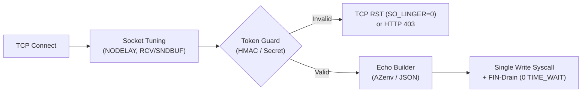

[← Back to Hydra README](../README.md)

[English](README.md) • [Русский](README.ru.md) • [简体中文](README.zh.md)

# hydra_judge

High-performance L7 echo server (HTTP/HTTPS) built on Tokio for proxy validation. Resolves the client's external IP address (`REMOTE_ADDR`), reflects incoming request headers (AZenv and JSON formats), classifies proxy anonymity levels, and shields against unauthorized scanners using authentication tokens and immediate TCP RST drops (`SO_LINGER=0`).

## File Structure

```text
hydra_judge/
├── .env.example                   # Environment variables configuration template
├── Cargo.lock                     # Locked build dependency versions
├── Cargo.toml                     # Package manifest and external dependencies
├── README.md                      # Module technical documentation
├── examples/
│   └── run_judge.rs               # Programmatic judge server launch example
├── src/
│   ├── config.rs                  # JudgeConfig configuration and parameter validation
│   ├── error.rs                   # Custom JudgeError error types
│   ├── lib.rs                     # Public library API and module exports
│   ├── main.rs                    # Standalone binary entry point
│   ├── metrics.rs                 # Lock-free telemetry counters (JudgeMetrics)
│   ├── tls.rs                     # rustls setup and self-signed certificate generation
│   ├── token.rs                   # Token validation and HMAC-SHA256 daily rotation
│   ├── formatters/
│   │   ├── azenv.rs               # Echo response serialization in AZenv format
│   │   ├── json.rs                # Echo response serialization in JSON format
│   │   └── mod.rs                 # Echo response format dispatcher
│   └── server/
│       ├── connection.rs          # Connection handling, HTTP parsing, and socket tuning
│       ├── mod.rs                 # JudgeServer network server and accept loop
│       └── security.rs            # Inbound request authorization token validation
└── tests/
    ├── anti_abuse_tests.rs        # Scanner defense and TCP RST drop tests
    ├── checker_integration.rs     # Integration tests with checker module
    ├── echo_format_tests.rs       # AZenv and JSON echo formatting correctness tests
    └── token_rotation_integration.rs # Daily token rotation integration tests
```

## Architectural Flow

1. **Accept & Socket Tuning**: Ingest incoming TCP socket (`TCP_NODELAY`, `SO_RCVBUF=8KB`, `SO_SNDBUF=4KB`), bounded by Tokio semaphore.
2. **TLS Handshake**: Optional TLS connection termination via `tokio-rustls` (HTTPS) with Slowloris mitigation timeouts.
3. **Parse & Token Guard**: Fast HTTP request parsing via `httparse`. Authorization token verification (Query / Path / `X-Hydra-Token`). Missing or invalid tokens trigger immediate `SO_LINGER=0` TCP RST (or HTTP 403).
4. **Echo Formatting**: Build response payload (`REMOTE_ADDR` + client headers + token) in AZenv or JSON format.
5. **Single Write & FIN-Drain**: Transmit entire response via a single write syscall (`Connection: close`) followed by FIN-drain (up to 20 ms) to eliminate `TIME_WAIT` socket buildup.



## Environment Configuration (ENV)

| Variable | Type | Default | Description |
| :--- | :---: | :---: | :--- |
| `HTTP_PORT` | `u16` | `8080` | Inbound port for HTTP traffic |
| `HTTPS_PORT` | `u16` | — | Inbound port for HTTPS traffic |
| `SECRET_TOKEN` | `string` | `hydra_secret_token` | Static request verification token |
| `SECRET_KEY` | `string` | — | HMAC key for daily rolling tokens |
| `UNAUTHORIZED_ACTION` | `string` | `drop_rst` | Action on unauthorized requests (`drop_rst` or `forbidden`) |
| `FORMAT` | `string` | `azenv` | Base echo response format (`azenv` or `json`) |
| `TLS_CERT_PATH` | `string` | — | Path to TLS certificate (PEM) |
| `TLS_KEY_PATH` | `string` | — | Path to TLS private key (PEM) |
| `MAX_REQUEST_BYTES` | `usize` | `4096` | Maximum allowed HTTP request size |
| `REQUEST_TIMEOUT_SECS` | `u64` | `3` | Connection processing timeout |
| `MAX_CONCURRENT_CONNECTIONS` | `usize` | `10000` | Maximum concurrent active connections |
| `RUST_LOG` | `string` | `info` | Log verbosity filter directive |

## Build & Run

### Build

```bash
cargo build --release -p hydra_judge
```

### Run

#### Linux / macOS
```bash
# Default execution
cargo run --release -p hydra_judge

# Execution with custom environment variables
HTTP_PORT=8080 SECRET_TOKEN=secret_key ./target/release/hydra_judge
```

#### Windows (PowerShell)
```powershell
# Default execution
cargo run --release -p hydra_judge

# Execution with custom environment variables
$env:HTTP_PORT="8080"; $env:SECRET_TOKEN="secret_key"; .\target\release\hydra_judge.exe
```

### Testing

```bash
cargo test -p hydra_judge
cargo run --example run_judge
```
