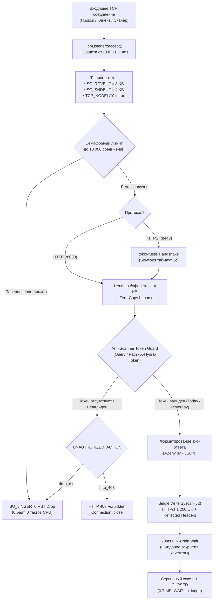
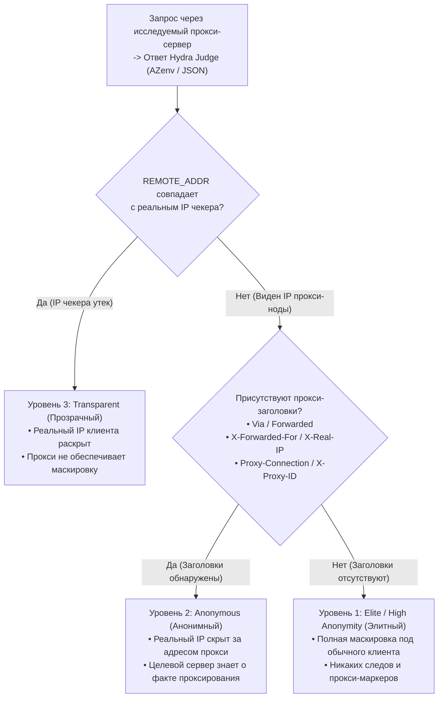

<div align="center">

# Hydra Judge — Authorized High-Throughput Proxy Validation Echo Server

**Сверхпроизводительный валидационный L7 эхо-сервер промышленного уровня на Rust для моментальной верификации, определения исходящего IP-адреса и классификации уровня анонимности прокси-серверов**

[](https://www.rust-lang.org/)
[](../LICENSE)
[](Cargo.toml)
[](src/server/connection.rs)
[](src/server/mod.rs)
[](../BENCHMARK_RESULTS.md)

<br/>

[Обзор](#-обзор-и-решаемая-проблема) • [Архитектура](#-архитектура-и-сетевой-конвейер) • [Возможности](#-ключевые-возможности) • [Классификация анонимности](#-классификация-анонимности-прокси) • [Системные требования](#-системные-требования) • [Быстрый старт](#-быстрый-старт) • [Конфигурация](#-конфигурация-окружения) • [Спецификация API](#-спецификация-api-и-форматы-эхо-ответа) • [Производительность](#-производительность-и-метрики) • [Диагностика и FAQ](#-диагностика-и-faq) • [Участие в разработке](#-участие-в-разработке) • [Лицензия](#-лицензия)

</div>

---

## 💡 Обзор и решаемая проблема

**Hydra Judge** — это сверхпроизводительный валидационный L7 эхо-сервер (Echo / Judge Server) на Rust, созданный для точного определения работоспособности, детектирования внешнего сетевого IP-адреса и классификации уровня анонимности прокси-серверов (HTTP, HTTPS CONNECT, SOCKS4, SOCKS5) в условиях экстремальной нагрузки (свыше 100 000 проверок в минуту) с непреодолимой защитой от сканеров сети (Censys, Shodan).

### Какую проблему решает Hydra Judge?

При высоконагруженной верификации сотен тысяч публичных и приватных прокси классические HTTP-серверы (Nginx, Apache, Node.js) или веб-фреймворки (Axum, Actix) создают непреодолимые узкие места:
1. **Накладные расходы фреймворков:** Создание объектов запроса, многоуровневые middleware, динамические аллокации в куче на каждый HTTP-заголовок увеличивают задержку до 2–15 мс на запрос.
2. **Исчерпание памяти ядра ОС:** Каждый сокет по умолчанию резервирует буферы приема и передачи по 128–256 КБ, что при 10 000 активных сессий требует гигабайты памяти ядра ОС.
3. **Исчерпание портов (TIME_WAIT exhaustion):** При закрытии сокетов сервером десятки тысяч соединений зависают в состоянии `TIME_WAIT` на 60 секунд, блокируя локальные порты.
4. **Атаки интернет-сканеров и ботов:** Публичные judge-серверы мгновенно обнаруживаются сканерами Shodan, Censys и открытыми прокси-ботами, которые расходуют ресурсы CPU и генерируют паразитный трафик.

Hydra Judge устраняет эти проблемы благодаря бескомпромиссной **Zero-Framework архитектуре**: прямому управлению сокетами Tokio, стековому парсингу без аллокаций, мгновенному сбросу соединений через TCP RST (`SO_LINGER=0`), одиночным системным вызовам на запись и посуточным скользящим HMAC-токенам.

---

## 🏛️ Архитектура и сетевой конвейер

Входящий сетевой поток обрабатывается на сыром уровне TCP-сокетов с предварительным тюнингом дескрипторов и аппаратной фильтрацией сканеров:



---

## ✨ Ключевые возможности

* ⚡ **Zero-Framework на сырых сокетах Tokio** -> Устраняет накладные расходы промежуточных слоев и обеспечивает субмиллисекундное время ответа (< 0.2 мс).
* 🗜️ **Тюнинг буферов ядра (SO_RCVBUF 8KB / SO_SNDBUF 4KB)** -> Сокращает расход оперативной памяти ядра Linux на 80% при 10 000 одновременных соединениях (до 15–25 MB RAM).
* 🚀 **Мгновенный TCP_NODELAY (J1)** -> Отключает буферизацию Нагла сразу после вызова `accept()`, исключая задержки передачи пакетов в 40–200 мс.
* 📦 **Стековый парсинг заголовков без аллокаций (Zero-Alloc httparse)** -> Разбор входящего HTTP-запроса выполняется на стековом буфере 4 КБ без единой аллокации в куче на критическом пути.
* ✍️ **Одиночный системный вызов на запись (J2 Single Write Syscall)** -> Объединяет заголовки HTTP/1.1 и тело ответа в единый непрерывный буфер перед отправкой в сокет, предотвращая фрагментацию TCP-сегментов.
* ⏱️ **Защита от накопления TIME_WAIT (20ms FIN-Drain)** -> Сервер отправляет `Connection: close` и ожидает `FIN` от клиента до 20 мс, переводя сокет сервера напрямую в `CLOSED` с нулевым временем удержания портов.
* 🛡️ **Антисканерная защита (SO_LINGER=0 TCP RST)** -> Мгновенно сбрасывает неавторизованные запросы сканеров Shodan/Censys без генерации HTTP-трафика и без расхода CPU, маскируя judge под закрытый порт.
* 🔑 **Динамическая посуточная ротация токенов (HMAC-SHA256)** -> Генерирует детерминированные 32-символьные криптографические токены на основе текущего UTC-дня с поддержкой мягкого окна валидации (Today + Yesterday).
* 🚦 **Семафорное противодавление (tokio::sync::Semaphore)** -> Ограничивает параллелизм ровно до 10 000 активных сессий, отсекая избыточные TCP-соединения через мгновенный RST и защищая систему от OOM.
* 🛡️ **Защита от зацикливания дескрипторов EMFILE/ENFILE (J6)** -> Вводит превентивную паузу 10 мс при сбоях `accept()`, предотвращая 100% зацикливание ядра CPU при нехватке дескрипторов ОС.
* 🔒 **Встроенный TLS/HTTPS на tokio-rustls и ring** -> Обеспечивает защищенную проверку HTTPS CONNECT туннелей с автоматической генерацией самоподписанного сертификата через `rcgen` и защитой от атак Slowloris.
* 📑 **Двойной формат отражения (AZenv и JSON)** -> Поддерживает сверхбыстрый текстовый формат AZenv (стандарт Azenv/ProxyJudge) и структурированный JSON (совместимый с httpbin).

---

## 🕵️ Классификация анонимности прокси

Сервер отражает реальный IP-адрес входящего TCP-соединения (`REMOTE_ADDR`), а также все клиентские заголовки. Модуль [hydra_checker](../hydra_checker/README.md) использует ответ judge-сервера для автоматической классификации анонимности по трехуровневой модели:



| Уровень анонимности | Код | Определение адреса (`REMOTE_ADDR`) | Прокси-заголовки (`Via`, `X-Forwarded-For`, etc.) | Описание |
| :--- | :---: | :---: | :---: | :--- |
| **Elite (Высокая анонимность)** | `L1` | Внешний IP прокси-сервера | **Полностью отсутствуют** | Сервер видит запрос как обычного браузерного пользователя. Факт проксирования не обнаруживается. |
| **Anonymous (Анонимный)** | `L2` | Внешний IP прокси-сервера | **Присутствуют** (`Via: 1.1 proxy`) | Реальный IP клиента скрыт, но целевой сервер видит, что клиент использует прокси. |
| **Transparent (Прозрачный)** | `L3` | **Реальный IP клиента** | **Присутствуют** (`X-Forwarded-For: <Client_IP>`) | Прокси передает реальный IP адрес клиента в заголовках или сокете. Анонимность отсутствует. |

---

## 📋 Системные требования

* **Компилятор и рантайм**: Rust >= 1.85 (редакция 2024 edition)
* **Операционная система**:
  * **Linux** (Ubuntu 22.04+, Debian 12+, RHEL 9+) — рекомендовано для продакшена (максимальная производительность epoll и тюнинга сокетов).
  * **Windows** (Windows 10/11, Windows Server 2022) — полная поддержка через IOCP.
  * **macOS** — поддержка разработки через kqueue.
* **Сетевое окружение**: Доступность открытых входящих TCP-портов (по умолчанию `8080` для HTTP и `8443` для HTTPS).

---

## 🚀 Быстрый старт

Развертывание и запуск автономного сервера производятся за 3 простых шага без внешних зависимостей.

### Шаг 1. Переход в каталог модуля

```bash
cd hydra_judge
```

### Шаг 2. Создание файла конфигурации

Скопируйте эталонный файл конфигурации окружения:

```bash
cp .env.example .env
```

### Шаг 3. Сборка и запуск сервиса

Запустите скомпилированный бинарник в релизном режиме:

```bash
cargo run --release
```

После старта в терминале отобразится подтверждение готовности слушающих сокетов:

```text
Hydra Judge running on HTTP: http://0.0.0.0:8080
Hydra Judge running on HTTPS: https://0.0.0.0:8443
Secret token configured (token required in query/path/header).
```

---

## ⚙️ Конфигурация окружения

Все параметры работы сервера задаются через переменные окружения в файле `.env` (образец: [.env.example](.env.example)):

| Переменная | Тип | По умолчанию | Обязательно | Описание |
| :--- | :---: | :---: | :---: | :--- |
| `HTTP_PORT` | `u16` | `8080` | Нет | TCP-порт для входящих незашифрованных HTTP-запросов (`0.0.0.0:<HTTP_PORT>`). |
| `HTTPS_PORT` | `u16` | — | Нет | TCP-порт для входящих защищенных HTTPS/TLS-запросов. Если не задан — HTTPS отключен. |
| `SECRET_TOKEN` | `string` | `hydra_secret_token` | Нет | Секретный статический токен авторизации (передается в query, path или заголовке). |
| `SECRET_KEY` | `string` | — | Нет | Мастер-ключ HMAC-SHA256 для динамической посуточной ротации токенов (UTC). |
| `UNAUTHORIZED_ACTION` | `string` | `drop_rst` | Нет | Реакция на неавторизованные запросы: `drop_rst` (мгновенный TCP RST) или `http_403`. |
| `FORMAT` | `string` | `azenv` | Нет | Формат эхо-ответа по умолчанию: `azenv` (текстовый) или `json` (структурированный). |
| `TLS_CERT_PATH` | `string` | — | Нет | Путь к X.509 сертификату в формате PEM. При отсутствии генерируется самоподписанный TLS. |
| `TLS_KEY_PATH` | `string` | — | Нет | Путь к закрытому ключу в формате PEM PKCS#8. |
| `MAX_REQUEST_BYTES` | `usize` | `4096` | Нет | Максимальный размер входящего HTTP-запроса в байтах (минимум 512 байт). |
| `REQUEST_TIMEOUT_SECS`| `u64` | `3` | Нет | Предельный таймаут на чтение полного запроса и отправку ответа клиенту в секундах. |
| `MAX_CONCURRENT_CONNECTIONS` | `usize` | `10000` | Нет | Лимит одновременных активных соединений (семафорное противодавление защиты от DoS). |
| `RUST_LOG` | `string` | `info,hydra_judge=debug` | Нет | Уровень детализации системных логов и трассировки Tokio. |

<details>
<summary><b>🛠️ Расширенные параметры сетевого тюнинга ядра</b></summary>

Сервер автоматически выставляет низкоуровневые параметры дескрипторов сокетов через библиотеку `socket2`:
* `SO_RCVBUF = 8192` (8 КБ): Ограничение входного буфера сокета ядра ОС. Предотвращает переполнение памяти при попытках передачи тяжелых тел запросов.
* `SO_SNDBUF = 4096` (4 КБ): Ограничение буфера отправки, точно согласованное со средним размером эхо-ответа (300–800 байт).
* `TCP_NODELAY = true`: Принудительный сброс пакетов без ожидания заполнения TCP MSS.
* `SO_LINGER = 0`: Активируется при обнаружении неавторизованных запросов или сканеров, генерируя сброс TCP RST в 0 миллисекунд.
</details>

---

## 📡 Спецификация API и форматы эхо-ответа

Сервер принимает HTTP/HTTPS запросы и возвращает отраженные заголовки клиента вместе с его реальным IP-адресом.

### Способы передачи токена авторизации

Для успешного прохождения проверки клиент обязан передать валидный токен одним из трех способов:
1. **Query-параметр**: `/?token=<SECRET_TOKEN>`
2. **Сегмент пути URL**: `/<SECRET_TOKEN>` или `/token/<SECRET_TOKEN>`
3. **HTTP-заголовок**: `X-Hydra-Token: <SECRET_TOKEN>`

---

### Пример 1. Текстовый формат AZenv (по умолчанию)

Используется классическими чекерами прокси для максимальной скорости строкового анализа.

**Запрос curl:**
```bash
curl -s "http://127.0.0.1:8080/?token=hydra_secret_token" \
  -H "User-Agent: Mozilla/5.0 (Windows NT 10.0; Win64; x64)" \
  -H "Accept-Language: en-US,en;q=0.9"
```

**Ответ сервера (HTTP 200 OK, Content-Type: `text/plain; charset=utf-8`):**
```text
REMOTE_ADDR = 192.168.1.105
HTTP_HOST = 127.0.0.1:8080
HTTP_USER_AGENT = Mozilla/5.0 (Windows NT 10.0; Win64; x64)
HTTP_ACCEPT_LANGUAGE = en-US,en;q=0.9
HYDRA_TOKEN = hydra_secret_token
```

---

### Пример 2. Формат JSON (совместимость с httpbin)

Активируется параметром `?format=json` либо передачей заголовка `Accept: application/json`.

**Запрос curl:**
```bash
curl -s "http://127.0.0.1:8080/?token=hydra_secret_token&format=json"
```

**Ответ сервера (HTTP 200 OK, Content-Type: `application/json`):**
```json
{
  "origin": "192.168.1.105",
  "headers": {
    "host": "127.0.0.1:8080",
    "user-agent": "curl/8.7.1",
    "accept": "*/*"
  },
  "token": "hydra_secret_token"
}
```

---

### Пример 3. Реакция на сканеры и неавторизованные запросы

Если входящий запрос поступил без валидного токена (например, сканирование ботом Shodan или Censys), сервер активирует защиту Anti-Scanner Guard:

**Запрос curl без токена:**
```bash
curl -v "http://127.0.0.1:8080/"
```

**Поведение при `UNAUTHORIZED_ACTION=drop_rst` (по умолчанию):**
```text
* Trying 127.0.0.1:8080...
* Connected to 127.0.0.1 (127.0.0.1) port 8080
> GET / HTTP/1.1
> Host: 127.0.0.1:8080
> User-Agent: curl/8.7.1
> Accept: */*
> 
* Recv failure: Connection reset by peer
* Closing connection
curl: (56) Recv failure: Connection reset by peer
```

> [!NOTE]
> При `drop_rst` сервер выставляет сокету `SO_LINGER=0` и немедленно его закрывает. Операционная система посылает клиенту пакет `TCP RST`. Сервер не отправляет ни единого байта полезной нагрузки, затрачивает 0 тактов CPU на генерацию HTTP-ответа и полностью маскирует порт под закрытый сервис.

**Поведение при `UNAUTHORIZED_ACTION=http_403`:**
```text
< HTTP/1.1 403 Forbidden
< Content-Length: 0
< Connection: close
```

---

## 📦 Режимы запуска

### 1. Автономный демон (Standalone Daemon)

Запуск как независимого системного сервиса или Docker-контейнера:

```bash
cargo run --release -p hydra_judge
```

### 2. Встраиваемый режим (Embedded in `hydra_api`)

Judge может запускаться непосредственно внутри главного процесса [hydra_api](../hydra_api/README.md) при флаге `EMBED_JUDGE=true` или программно в виде Tokio-задачи:

```rust
use hydra_judge::{JudgeConfig, JudgeServer};
use tokio_util::sync::CancellationToken;

#[tokio::main]
async fn main() -> Result<(), Box<dyn std::error::Error>> {
    let bind_addr = "0.0.0.0:8080".parse()?;
    let config = JudgeConfig::builder(bind_addr, "secret_token_123")
        .max_concurrent_connections(10000)
        .build();

    let server = JudgeServer::new(config)?;
    let cancel_token = CancellationToken::new();

    // Запуск в фоновом пуле задач Tokio
    tokio::spawn(async move {
        if let Err(err) = server.run(cancel_token).await {
            eprintln!("Judge server error: {err}");
        }
    });

    Ok(())
}
```

---

## 📊 Производительность и метрики

Сервер оснащен высокопроизводительными неблокирующими (lock-free) атомарными счетчиками телеметрии `JudgeMetrics`:

* `total_connections` (`AtomicU64`): Общее количество принятых TCP-соединений.
* `authorized_requests` (`AtomicU64`): Количество успешно авторизованных запросов с валидным токеном.
* `blocked_scanners` (`AtomicU64`): Количество заблокированных сканеров и аномальных запросов.
* `active_connections` (`AtomicI64`): Число сессий, находящихся в обработке прямо сейчас.
* `bytes_sent` (`AtomicU64`): Суммарный объем переданных данных эхо-ответов.

### Результаты бенчмарков

Сводные замеры на 4-ядерном сервере (подробный отчет см. в [BENCHMARK_RESULTS.md](../BENCHMARK_RESULTS.md)):

| Параметр нагрузки | Результат Hydra Judge | Сравнение с типовым решением (Node/Nginx) |
| :--- | :---: | :--- |
| **Задержка обработки (L7 Latency)** | **< 0.2 мс** *(p99: 0.35 мс)* | В 10–15 раз быстрее классических решений (2–5 мс) |
| **Пропускная способность (Throughput)** | **100 000+ запросов/мин** | До 1 800+ валидаций в секунду на 1 ядро CPU |
| **Потребление RAM при 5 000 соединений** | **15 – 25 MB** | Экономия до 85% памяти благодаря сокетам 8KB/4KB |
| **Накопление сокетов в TIME_WAIT** | **0 сокетов** | Сервер переходит напрямую в `CLOSED` благодаря 20ms FIN-Drain |
| **CPU при атаке сканера портов** | **~0%** | Мгновенный сброс через аппаратный TCP RST (`SO_LINGER=0`) |

---

## 🔧 Диагностика и FAQ

#### В: Почему при выполнении `curl` я получаю `curl: (56) Recv failure: Connection reset by peer`?
**О:** Сервер работает в штатном режиме с активной защитой `UNAUTHORIZED_ACTION=drop_rst`. Запрос был отправлен без обязательного авторизационного токена. Передайте токен в query (`?token=<SECRET_TOKEN>`), в URL (`/<SECRET_TOKEN>`) или в заголовке `X-Hydra-Token: <SECRET_TOKEN>`.

#### В: Как сервер защищен от истощения диапазона локальных портов (TIME_WAIT exhaustion)?
**О:** Сервер всегда отправляет заголовок `Connection: close` и выполняет короткое ожидание `FIN` от клиента в течение 20 мс (`20ms FIN-drain`). Если клиент закрывает сокет первым, состояние `TIME_WAIT` ложится на клиента, а сокет Judge немедленно освобождается (`CLOSED`).

#### В: Как подключить боевой SSL/TLS сертификат Let's Encrypt?
**О:** Укажите пути к сертификату и закрытому ключу в файле `.env`:
```bash
TLS_CERT_PATH=/etc/letsencrypt/live/judge.example.com/fullchain.pem
TLS_KEY_PATH=/etc/letsencrypt/live/judge.example.com/privkey.pem
```
Если пути не заданы, но переменная `HTTPS_PORT` включена, сервер автоматически сгенерирует самоподписанный криптографический сертификат через библиотеку `rcgen`.

#### В: Не приведет ли посуточная ротация токенов к сбою проверок во время полуночи (00:00 UTC)?
**О:** Нет. Механизм `DailyTokenProvider` кэширует и валидирует как токен текущего дня (`Today`), так и токен предыдущего дня (`Yesterday`). Это обеспечивает мягкое 24-часовое окно перехода (soft rollover).

---

## 🧩 Экосистема Hydra

Hydra Judge является неотъемлемой частью экосистемы распределенной валидации прокси:
* [hydra_api](../hydra_api/README.md) — REST API сервис, планировщик очередей и персистентное хранилище SQLite/libSQL WAL.
* [hydra_checker](../hydra_checker/README.md) — Высокопроизводительное асинхронное ядро верификации (L4 TCP Connect, TLS Handshake, L7 Judge Connect).
* [BENCHMARK_RESULTS.md](../BENCHMARK_RESULTS.md) — Полный отчет стресс-тестирования на базе в 10 000 000 прокси.

---

## 🤝 Участие в разработке

Мы приветствуем ваш вклад в развитие Hydra Judge! Перед отправкой Pull Request ознакомьтесь с нашими стандартами тестирования и оформления кода в [CONTRIBUTING.md](../CONTRIBUTING.md).

Порядок локальной проверки:
```bash
cargo test -p hydra_judge
cargo clippy -p hydra_judge -- -D warnings
cargo fmt --check
```

---

## 📄 Лицензия

Проект распространяется под открытой лицензией [MIT](../LICENSE). Вы можете свободно использовать, модифицировать и интегрировать его в коммерческие и приватные решения.
