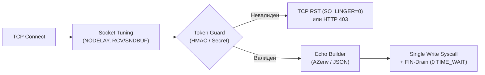

[← Назад к Hydra README](../README.ru.md)

[English](README.md) • [Русский](README.ru.md) • [简体中文](README.zh.md)

# hydra_judge

Высокопроизводительный L7 эхо-сервер (HTTP/HTTPS) на базе Tokio для валидации прокси-серверов. Определяет внешний IP-адрес клиента (`REMOTE_ADDR`), отражает заголовки запроса (форматы AZenv и JSON), классифицирует уровень анонимности и блокирует сканеры с помощью токенов авторизации и сброса TCP RST (`SO_LINGER=0`).

## Структура файлов

```text
hydra_judge/
├── .env.example                   # Шаблон конфигурации переменных окружения
├── Cargo.lock                     # Фиксация версий зависимостей сборки
├── Cargo.toml                     # Манифест пакета и внешние зависимости
├── README.md                      # Документация модуля
├── examples/
│   └── run_judge.rs               # Пример программного запуска сервера
├── src/
│   ├── config.rs                  # Конфигурация JudgeConfig и валидация параметров
│   ├── error.rs                   # Пользовательские типы ошибок JudgeError
│   ├── lib.rs                     # Публичный API библиотеки и экспорт модулей
│   ├── main.rs                    # Точка входа автономного бинарного приложения
│   ├── metrics.rs                 # Lock-free счетчики телеметрии JudgeMetrics
│   ├── tls.rs                     # Настройка rustls и автогенерация сертификатов
│   ├── token.rs                   # Валидация токенов и суточная ротация HMAC-SHA256
│   ├── formatters/
│   │   ├── azenv.rs               # Сериализация эхо-ответа в формат AZenv
│   │   ├── json.rs                # Сериализация эхо-ответа в формат JSON
│   │   └── mod.rs                 # Диспетчеризация форматирования эхо-ответа
│   └── server/
│       ├── connection.rs          # Обработка соединений, парсинг HTTP и сокет-тюнинг
│       ├── mod.rs                 # Сетевой сервер JudgeServer и accept-цикл
│       └── security.rs            # Проверка токенов авторизации в запросе
└── tests/
    ├── anti_abuse_tests.rs        # Тесты защиты от сканеров и сброса RST
    ├── checker_integration.rs     # Интеграционные тесты взаимодействия с чекером
    ├── echo_format_tests.rs       # Тесты корректности форматов AZenv и JSON
    └── token_rotation_integration.rs # Интеграционные тесты суточной ротации токенов
```

## Архитектурный поток

1. **Accept & Socket Tuning**: Прием входящего TCP-сокета (`TCP_NODELAY`, `SO_RCVBUF=8KB`, `SO_SNDBUF=4KB`), контроль лимита семафором.
2. **TLS Handshake**: Опциональное TLS-соединение через `tokio-rustls` (HTTPS) с защитой от Slowloris.
3. **Parse & Token Guard**: Разбор HTTP-запроса через `httparse`. Проверка токена (Query / Path / `X-Hydra-Token`). При отсутствии/невалидности — мгновенный `SO_LINGER=0` TCP RST (или HTTP 403).
4. **Echo Formatting**: Формирование тела ответа (`REMOTE_ADDR` + клиентские заголовки + токен) в формате AZenv или JSON.
5. **Single Write & FIN-Drain**: Отправка ответа единым системным вызовом (`Connection: close`) и ожидание FIN (до 20 мс) для предотвращения накопления `TIME_WAIT`.



## Конфигурация окружения (ENV)

| Переменная | Тип | Дефолт | Назначение (3-5 слов) |
| :--- | :---: | :---: | :--- |
| `HTTP_PORT` | `u16` | `8080` | Входящий порт для HTTP-трафика |
| `HTTPS_PORT` | `u16` | — | Входящий порт для HTTPS-трафика |
| `SECRET_TOKEN` | `string` | `hydra_secret_token` | Статический токен авторизации запросов |
| `SECRET_KEY` | `string` | — | HMAC-ключ суточной ротации токенов |
| `UNAUTHORIZED_ACTION` | `string` | `drop_rst` | Действие при неавторизованном запросе |
| `FORMAT` | `string` | `azenv` | Базовый формат эхо-ответа |
| `TLS_CERT_PATH` | `string` | — | Путь к сертификату PEM |
| `TLS_KEY_PATH` | `string` | — | Путь к закрытому ключу |
| `MAX_REQUEST_BYTES` | `usize` | `4096` | Максимальный размер HTTP-запроса |
| `REQUEST_TIMEOUT_SECS` | `u64` | `3` | Таймаут обработки клиентского соединения |
| `MAX_CONCURRENT_CONNECTIONS` | `usize` | `10000` | Лимит параллельных активных соединений |
| `RUST_LOG` | `string` | `info` | Уровень фильтрации сообщений лога |

## Сборка и запуск

### Сборка

```bash
cargo build --release -p hydra_judge
```

### Запуск

#### Linux / macOS
```bash
# Запуск по умолчанию
cargo run --release -p hydra_judge

# Запуск с переменными окружения
HTTP_PORT=8080 SECRET_TOKEN=secret_key ./target/release/hydra_judge
```

#### Windows (PowerShell)
```powershell
# Запуск по умолчанию
cargo run --release -p hydra_judge

# Запуск с переменными окружения
$env:HTTP_PORT="8080"; $env:SECRET_TOKEN="secret_key"; .\target\release\hydra_judge.exe
```

### Тестирование

```bash
cargo test -p hydra_judge
cargo run --example run_judge
```
