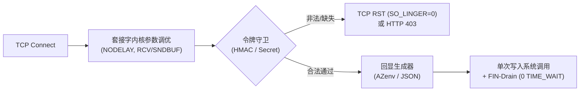

[← 返回 Hydra README](../README.zh.md)

[English](README.md) • [Русский](README.ru.md) • [简体中文](README.zh.md)

# hydra_judge

基于 Tokio 构建的高性能 L7 回显服务（HTTP/HTTPS），专门用于代理验证与匿名度评估。可精准识别客户端真实出口 IP（`REMOTE_ADDR`）、原样镜像请求头报文（支持 AZenv 与 JSON 格式）、多维评估代理匿名等级，并通过认证令牌及即时 TCP RST 重置（`SO_LINGER=0`）强力阻断恶意扫描。

## 目录结构

```text
hydra_judge/
├── .env.example                   # 环境变量配置模板
├── Cargo.lock                     # 构建依赖版本锁定文件
├── Cargo.toml                     # 软件包清单与依赖声明
├── README.md                      # 模块技术说明文档
├── examples/
│   └── run_judge.rs               # 裁判服务代码级嵌入启动示例
├── src/
│   ├── config.rs                  # JudgeConfig 参数解析与合法性校验
│   ├── error.rs                   # 自定义错误枚举 JudgeError
│   ├── lib.rs                     # 核心库公共 API 与模块重新导出
│   ├── main.rs                    # 独立二进制服务程序执行入口
│   ├── metrics.rs                 # 无锁原子计数遥测指标（JudgeMetrics）
│   ├── tls.rs                     # rustls 协议栈配置与自签名证书自动生成
│   ├── token.rs                   # 令牌鉴权与基于 HMAC-SHA256 的每日轮替计算
│   ├── formatters/
│   │   ├── azenv.rs               # AZenv 纯文本格式回显序列化实现
│   │   ├── json.rs                # 结构化 JSON 格式回显序列化实现
│   │   └── mod.rs                 # 回显报文格式分发调度器
│   └── server/
│       ├── connection.rs          # 连接状态机、零拷贝 HTTP 解析与套接字调优
│       ├── mod.rs                 # JudgeServer 网络主服务及连接 accept 循环
│       └── security.rs            # 入站请求鉴权防伪令牌多渠道提取校验
└── tests/
    ├── anti_abuse_tests.rs        # 防扫描滥用与即时 RST 阻断测试
    ├── checker_integration.rs     # 与 checker 检测模块的端到端集成测试
    ├── echo_format_tests.rs       # AZenv 与 JSON 回显格式合规性测试
    └── token_rotation_integration.rs # 每日动态令牌轮替机制集成测试
```

## 架构工作流

1. **Accept & Socket Tuning**：接收 TCP 套接字（配置 `TCP_NODELAY`、`SO_RCVBUF=8KB`、`SO_SNDBUF=4KB`），受 Tokio 信号量全局并发保护。
2. **TLS Handshake**：可选的 `tokio-rustls`（HTTPS）加密握手会话，配置超时防御 Slowloris 攻击。
3. **Parse & Token Guard**：基于 `httparse` 高速解析 HTTP 请求。通过 Query、Path 或 `X-Hydra-Token` 提取并验证令牌。若令牌缺失或无效，立即执行 `SO_LINGER=0` 发送 TCP RST（或返回 HTTP 403）。
4. **Echo Formatting**：构造回显数据载荷（`REMOTE_ADDR` + 客户端入站请求头 + 防伪令牌），输出为标准 AZenv 或 JSON 格式。
5. **Single Write & FIN-Drain**：通过单次系统调用输出完整响应报文（`Connection: close`），并在 FIN 状态微秒级排空（最多等待 20 毫秒），彻底杜绝系统 `TIME_WAIT` 套接字残留。



## 环境变量配置 (ENV)

| 环境变量 | 类型 | 默认值 | 用途说明 |
| :--- | :---: | :---: | :--- |
| `HTTP_PORT` | `u16` | `8080` | HTTP 协议服务监听端口 |
| `HTTPS_PORT` | `u16` | — | HTTPS 协议服务监听端口 |
| `SECRET_TOKEN` | `string` | `hydra_secret_token` | 用于验证回显合法性的静态令牌 |
| `SECRET_KEY` | `string` | — | 用于每日动态 HMAC-SHA256 令牌轮替密钥 |
| `UNAUTHORIZED_ACTION` | `string` | `drop_rst` | 遇到未授权请求时的处置行为（`drop_rst` 或 `forbidden`） |
| `FORMAT` | `string` | `azenv` | 基础回显数据输出格式（`azenv` 或 `json`） |
| `TLS_CERT_PATH` | `string` | — | TLS 服务证书路径 (PEM 格式) |
| `TLS_KEY_PATH` | `string` | — | TLS 私钥文件路径 (PEM 格式) |
| `MAX_REQUEST_BYTES` | `usize` | `4096` | 允许接收的最大 HTTP 请求字节数 |
| `REQUEST_TIMEOUT_SECS` | `u64` | `3` | 客户端连接完整处理超时（秒） |
| `MAX_CONCURRENT_CONNECTIONS` | `usize` | `10000` | 全局活跃并发连接最大限制数 |
| `RUST_LOG` | `string` | `info` | 系统运行日志级别过滤规则 |

## 编译与运行

### 编译构建

```bash
cargo build --release -p hydra_judge
```

### 启动服务

#### Linux / macOS
```bash
# 默认配置运行
cargo run --release -p hydra_judge

# 自定义环境变量运行
HTTP_PORT=8080 SECRET_TOKEN=secret_key ./target/release/hydra_judge
```

#### Windows (PowerShell)
```powershell
# 默认配置运行
cargo run --release -p hydra_judge

# 自定义环境变量运行
$env:HTTP_PORT="8080"; $env:SECRET_TOKEN="secret_key"; .\target\release\hydra_judge.exe
```

### 运行测试

```bash
cargo test -p hydra_judge
cargo run --example run_judge
```
